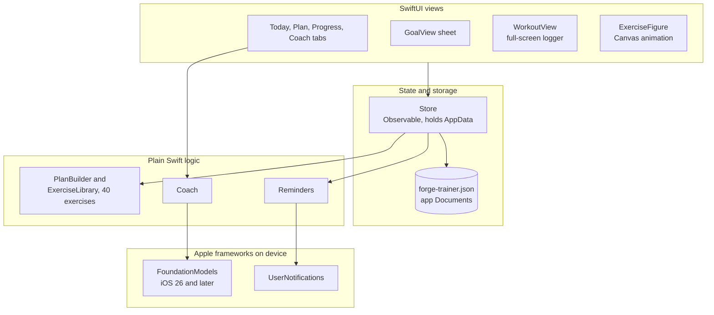
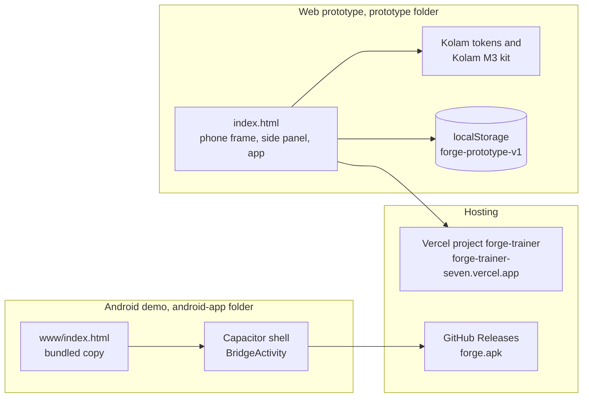
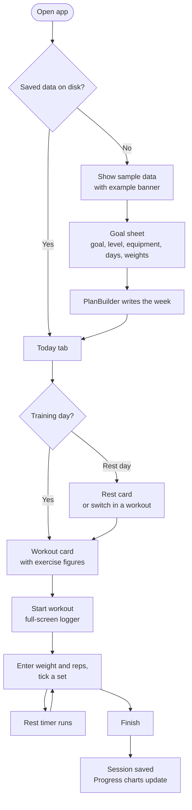
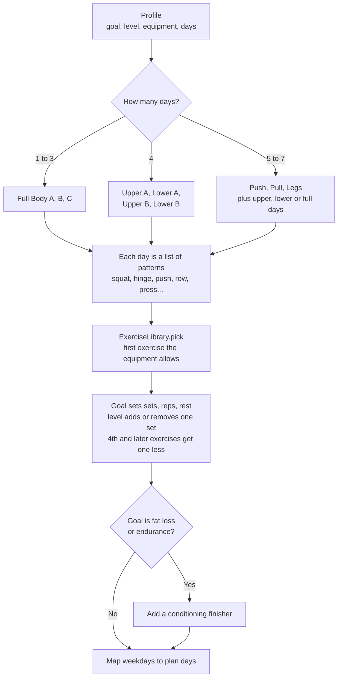
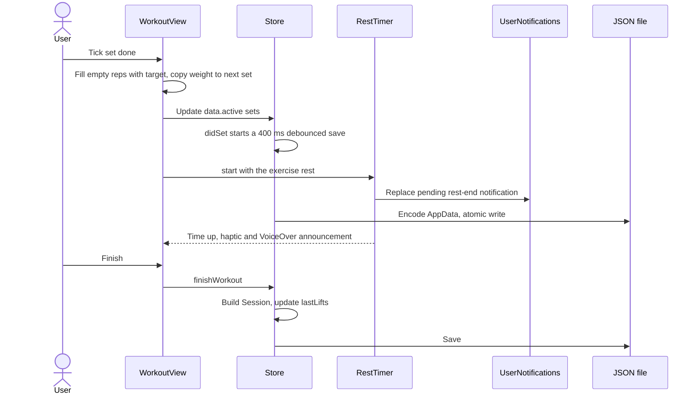
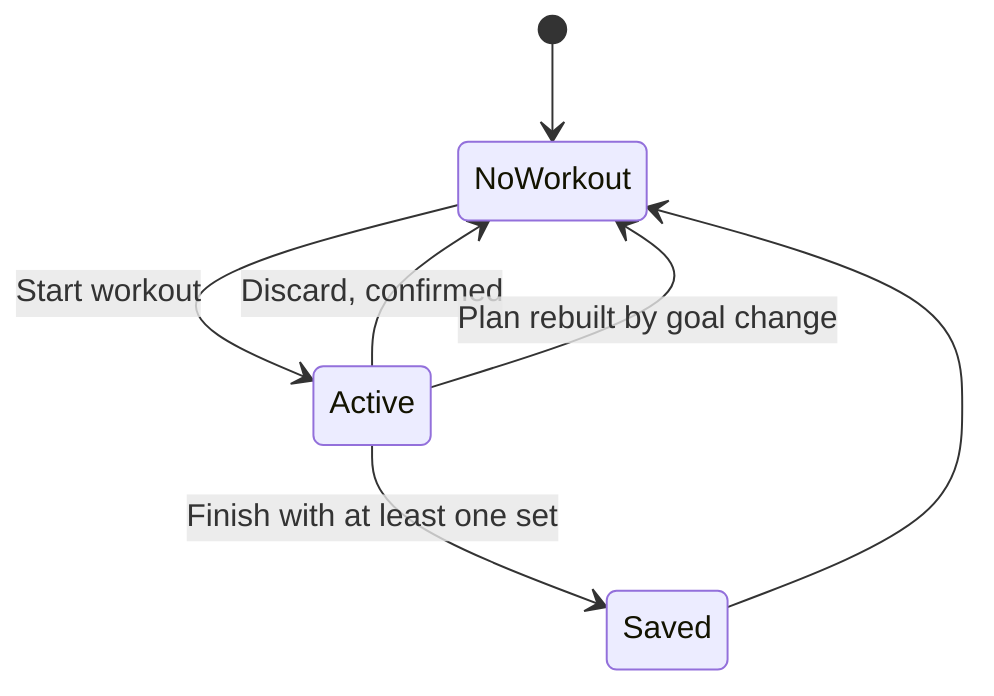
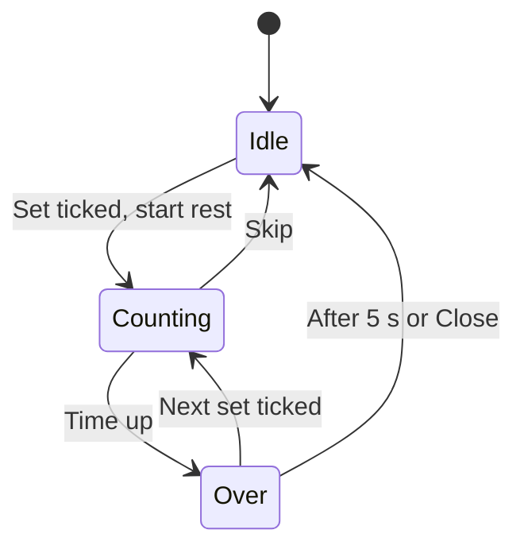
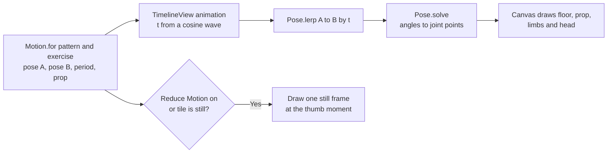
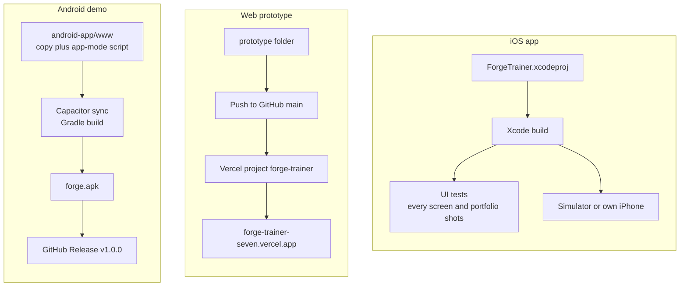

# Forge

Forge is a personal trainer for iPhone. You pick a goal, your level, your equipment and your training days, and Forge writes a weekly plan, shows each exercise as an animated figure, logs your sets with a rest timer, and charts your progress. The main idea is that everything runs on the phone: the plan comes from a small rule-based builder, the figures are drawn in code from joint angles, the data is one JSON file, and the coach uses Apple's on-device model when it can. A web prototype and an Android demo let people try the design without an iPhone.

| | |
|---|---|
| **Platforms** | iOS 18+ native app (SwiftUI, iPhone). Web prototype. Android demo (Capacitor). |
| **Stack** | Swift, SwiftUI, Observation, Swift Charts, UserNotifications, FoundationModels. Vanilla JS and canvas for the prototype. |
| **Data** | One JSON file in the app's Documents folder. The prototype uses localStorage. No server, no account. |
| **Hosting** | Prototype on Vercel. Android APK on GitHub Releases. The iOS app is built from Xcode. |

## System architecture

The real product is the native iOS app. All its views read and write one observable `Store`, which holds the whole app state as a single `AppData` value and saves it to disk. Plan building, the exercise library, the coach and reminders are plain Swift types with no network calls.

_The native iOS app. Every arrow is an in-process call; nothing leaves the phone. Progress charts use Swift Charts._

The web prototype is a separate, single-file port of the same design, used for the portfolio. The Android demo wraps a copy of that prototype.

_The demos. The Android app ships its web files inside the APK; it does not load the live site._

## Main user flow

On first launch the app shows a sample trainee called Alex, with a banner. Anything that would write real data, such as starting a workout or logging weight, sends the user to the goal sheet first. Saving the goal replaces the sample with the user's own data and a fresh plan.

### How the plan is generated

`PlanBuilder.build` is a deterministic rule set. The number of training days picks a split, each split day is a list of movement patterns, and each pattern becomes one exercise chosen from the library for the user's equipment. The goal sets the sets, reps and rest; the level adds or removes a set.

_Core work is timed, 30 or 40 seconds; carries are 4 reps. Equipment falls back: full gym can use dumbbell or bodyweight moves, dumbbells can use bodyweight._

| Goal | Sets | Reps | Rest |
|---|---|---|---|
| Build muscle | 4 | 8-12 | 90 s |
| Get stronger | 5 | 5 | 180 s |
| Lose fat | 3 | 12-15 | 45 s, plus finisher |
| Endurance | 3 | 15-20 | 30 s, plus finisher |
| Stay fit | 3 | 10 | 60 s |

Changing goal, level, equipment or days in the goal sheet rebuilds the plan and drops any workout in progress. Changing only weights, name or reminders keeps the plan. Users can also swap an exercise, or change its sets and reps, from the Plan tab.

## Data flow and state

The key path is logging a set. Ticking a set changes `store.data`, which schedules a save, and starts the rest timer, which also schedules a local notification in case the app goes to the background.

_The file is also saved immediately when the app leaves the foreground._

### Workout session and rest timer

A workout in progress is stored in `data.active`, so it survives the app being closed. The full-screen logger is shown whenever that value is set.

_Workout session states. While active, sets can be ticked, edited or added; finishing with nothing ticked shows a toast and keeps the workout open._

_Rest timer states in `RestTimer`. A +15s button extends the count. The bar turns amber in the last 10 seconds. "Over" shows "GO!" and fires a warning haptic._

The timer stores an end date, not a countdown, so the bar stays correct after the app is suspended. While the app is open the rest notification is suppressed by `NotificationDelegate`, because the in-app bar covers it.

### Progressive overload

When a workout starts, each set's weight is pre-filled. If the last time the user hit every set at the top of the rep range, Forge adds 2.5 kg for upper-body moves or 5 kg for lower-body moves (doubled in pounds) and rounds to 1.25 kg or 5 lb. Otherwise it repeats the last weight. Conditioning work has no weight.

### Where state lives

| State | Where | Notes |
|---|---|---|
| Profile, plan, sessions, weights, habits, chat, active workout | `AppData` in `forge-trainer.json` | Documents folder, ISO 8601 dates, complete file protection. Not SwiftData, Core Data or UserDefaults. |
| Best weight per exercise | `lastLifts` in the same file | Drives the suggested weight. |
| Swapped workout for today | `Store.swappedDay` | Memory only; resets on relaunch. |
| Rest timer | `RestTimer` in `WorkoutView` | Memory only, plus one pending notification. |
| Prototype state | localStorage `forge-prototype-v1` | Theme choice in `forge-proto-theme`. |

On every save the store trims old data: it keeps the last 500 sessions, the last 40 chat messages, and 120 days of habit check-ins.

### How the exercise figures move

There are no images or videos. Each movement pattern has two key poses written as joint angles for the torso, thigh, shin, upper arm and forearm. Limb lengths are fixed, so a pose is solved into joint points from the ankle up when the figure stands, or from the hip out when it lies or hangs. A prop such as a plate, dumbbell, bench or cable is drawn from the solved hand and hip positions.

_The frame box is the union of both poses, so the figure never drifts. The prototype ports the same maths to a canvas and requestAnimationFrame._

## Key modules

| File | Responsibility |
|---|---|
| `ForgeApp.swift` | App entry, tab view, goal sheet, workout cover, toasts, save on background. `-figureGallery` shows every figure. |
| `Models.swift` | Codable types: goal rules, profile, plan, sessions, active workout, chat, `AppData`. |
| `Store.swift` | The observable store: load, debounced save, trimming, goal updates, today, streaks, charts data, suggested weight, start and finish workout, sample data. |
| `Library.swift` | 12 movement patterns, 40 exercises with form cues, and `PlanBuilder`. |
| `ExerciseFigure.swift` | Pose model, props, motion library and the animated Canvas figure. |
| `WorkoutView.swift` | Set logger, `RestTimer`, rest bar, haptics, finish and discard. |
| `TodayView.swift` | Today screen: week circles, workout, done or rest card, rings, habits, exercise detail sheet. |
| `PlanView.swift` | The week, muscle balance, day cards, exercise edit sheet, rebuild plan. |
| `ProgressTab.swift` | Swift Charts for sets by muscle and weight, 16-week heatmap, best lifts, recent sessions, weight entry. |
| `GoalView.swift` | Goal form; starts fresh from the sample or updates the goal. |
| `Coach.swift`, `CoachView.swift` | Coach prompt built from the user's data, streamed on-device answers, built-in tips fallback, chat UI. |
| `Reminders.swift` | Weekly training reminders and the rest-end notification. |
| `Theme.swift` | Colours with Increase Contrast, Dynamic Type mapping, muscle groups, shared components. |
| `ForgeUITests.swift` | `testEveryScreen` taps through the app; `testPortfolioShots` takes the portfolio screenshots. |
| `prototype/index.html` | The whole web prototype in one file, including the canvas figures. |

## Platforms

**iOS (native).** SwiftUI app for iPhone, iOS 18 or later, bundle `com.gopinath.ForgeTrainer`. It uses stock Apple components such as `TabView`, `NavigationStack`, `Form`, menus and confirmation dialogs, following an Apple HIG audit recorded in `AUDIT-HIG.md`. It does not use a web view or the Kolam iOS kit.

**Web prototype.** A vanilla JavaScript port of the iOS design inside an iPhone-style frame, with a side panel of guided steps, the full exercise library, a theme switch and a Reset button. It uses Kolam tokens. The coach gives the built-in tips only, with a typed-out effect. The rest timer beeps with Web Audio instead of a notification.

**Android demo.** A Capacitor 8 shell, app id `com.gopinath.forgetrainer`, min SDK 24, target SDK 36. It is bundled: `android-app/www/index.html` is a copy of the prototype plus a small script that removes the iPhone frame and fits the app screen to the phone. Inside the shell the Kolam M3 kit adds `html.k-android` and the page switches to Material Design 3, with a navigation bar, M3 shapes and ripples, and a hardware Back handler that closes sheets, keeps a running workout open, returns to Today, then exits.

## Data sources and APIs

| Source | Used for | Licence / key |
|---|---|---|
| Built-in exercise library | Exercises, form cues, plan templates | Written in the code; no key |
| Apple FoundationModels | Coach answers on iOS 26 with Apple Intelligence | On-device system model; no key |
| UserNotifications | Training reminders, rest-end alert | Asks permission when a workout starts or reminders are turned on |
| Swift Charts | Progress charts | Apple framework |
| Google Fonts | Lato in the prototype | Open font licence |
| Kolam tokens and Kolam M3 kit | Prototype styling and Android mode | Copied into `kolam/` and `m3/` |

There is no backend and no third-party API. Git history shows a Google sign-in was added and then removed, so the current code has no account features.

## Offline, performance, privacy and accessibility

**Offline.** The iOS app works fully offline. The coach falls back to built-in tips when the on-device model is missing, off or still downloading, and the coach screen says why. The Android demo ships its files, but it loads Lato from Google Fonts, so text falls back to a system font offline. The web prototype has no service worker.

**Performance.** Saves are debounced by 400 ms and old data is trimmed. Figures animate only where they help: the Today workout card, the exercise detail and edit sheets, and the workout logger until an exercise is complete. Small list tiles are still frames.

**Privacy.** Training data stays on the phone in one protected file. The coach prompt is built from that data and sent only to Apple's on-device model.

**Accessibility.** Text follows Dynamic Type, colours respond to Increase Contrast, figures stop with Reduce Motion, set fields have VoiceOver labels, toasts and the end of a rest are announced, and touch targets are 44 pt or larger. The prototype honours `prefers-reduced-motion`.

## Build and deploy

_Three separate outputs from one repo._

| Output | How |
|---|---|
| iOS app | Open `ForgeTrainer.xcodeproj` and run the `ForgeTrainer` scheme. Not on the App Store. |
| Web prototype | The Vercel link file is in `prototype/.vercel/` and there is no `vercel.json`, so Vercel serves the `prototype` folder as a static site: `index.html`, `screens.html`, `case-study.html` and `shots/`. The commit "Vercel: ignore local link files; deploy from GitHub" switched it to deploy from pushes to `main`. |
| Android APK | Release `v1.0.0` holds `forge.apk`, last uploaded on 17 November 2026. The build script is not in the repo. |

## Known limits and next steps

- Data lives on one iPhone only. There is no export, backup or sync.
- The plan builder is rule-based. It does not adapt sets or exercises to logged results; only the suggested weight changes.
- Full coach answers need iOS 26 with Apple Intelligence. Older phones get four built-in tip topics.
- The web prototype and the Android demo are hand-ported copies of the Swift app. They must be updated by hand when the app changes.
- The APK build script is not committed to the repo, so rebuilding the Android demo depends on the shared local tooling.
- Open HIG items: Plan day cards are custom cards without swipe actions, and the Today hero cards get very tall at the largest text sizes.

---

Written from the source code on 17 November 2026. Source: github.com/tgopinath/ForgeTrainer
